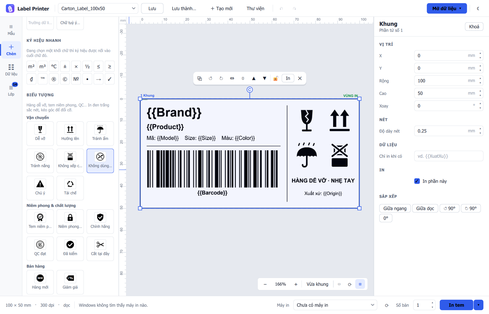
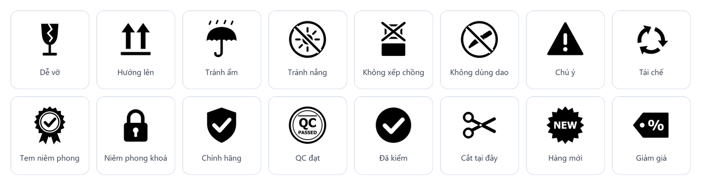
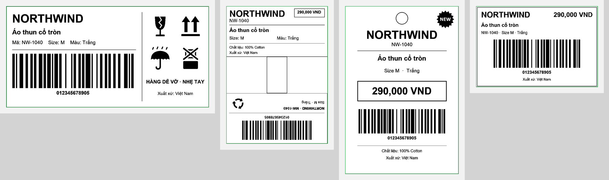

<div align="center">


# Temly

**Phần mềm thiết kế và in tem nhãn, mã vạch, mã QR, hang tag miễn phí cho Windows.**<br>
**Free label, barcode and hang tag designer for thermal and office printers on Windows.**

[](https://github.com/mrdivein/temly-label-designer/releases/latest)
[](https://github.com/mrdivein/temly-label-designer/actions/workflows/release.yml)


[**⬇ Tải bản cài đặt · Download**](https://github.com/mrdivein/temly-label-designer/releases/latest) &nbsp;·&nbsp;
[Tính năng · Features](#tính-năng--features) &nbsp;·&nbsp;
[Máy in · Printers](#máy-in-hỗ-trợ--supported-printers) &nbsp;·&nbsp;
[Mã nguồn · Source](#chạy-từ-mã-nguồn--run-from-source)

<br>



</div>

---

**Temly** là phần mềm thiết kế tem nhãn: kéo thả chữ, **mã vạch** (Code 128, EAN-13, UPC), **mã QR** và logo lên tem,
nối dữ liệu từ **Excel** hoặc **Google Sheets**, rồi in hàng loạt trên máy in tem nhiệt (Xprinter, Zebra, Godex, TSC…)
hoặc máy in văn phòng. Dùng cho tem sản phẩm, tem giá, tem thùng carton, tem vận chuyển, hang tag quần áo, tem trang sức,
tem kính mắt, tem mỹ phẩm và thực phẩm.

*Temly is a free label design and printing app for Windows: drag-and-drop barcodes, QR codes, text and logos, bind
them to Excel or Google Sheets, and batch-print on thermal label printers or any Windows printer — a lightweight
alternative to commercial barcode label software. Formerly “Label Printer”.*

## Tính năng · Features

<table>
<tr>
<td width="50%" valign="top">

### 🎨 Thiết kế tự do · Free-form design
Kéo thả chữ, mã vạch (Code 128, EAN-13, UPC…), mã QR, ảnh/logo, đường kẻ, khung và biểu tượng lên tem.
Kích thước tính bằng mm, có thước, lưới, căn chỉnh, xoay, nhóm phần tử và hoàn tác.

*Drag text, barcodes, QR codes, images, lines, boxes and symbols onto the label. Sizes in millimetres,
with rulers, grid, alignment, rotation, grouping and undo.*

</td>
<td width="50%" valign="top">

### 📊 Gắn dữ liệu · Data binding
Nối mẫu tem với cột của **Excel** hoặc **Google Sheet** bằng `{{TênCột}}`.
Quét mã vạch để tìm dòng, in một tem hay cả danh sách.

*Bind a template to Excel or Google Sheet columns with `{{Column}}`. Scan a barcode to find a row,
print one label or a whole list.*

</td>
</tr>
<tr>
<td valign="top">

### 🏷️ Tem gập hai mặt · Fold-over tags
Phần dưới đường gập được in lật 180° để gập thành hang tag hai mặt. Vùng in giúp canh nội dung.

*Everything below the fold line prints rotated 180° so the tag folds into a two-sided hang tag.*

</td>
<td valign="top">

### 🖨️ In chính xác · Accurate printing
In RAW ZPL cho máy in tem hoặc qua driver Windows; xuất PDF. In thử, bù tỉ lệ / độ lệch và hồ sơ máy in.

*RAW ZPL to label printers or the Windows driver; PDF export. Test prints, scale/offset
compensation and saved printer profiles.*

</td>
</tr>
<tr>
<td valign="top">

### 🔄 Tự cập nhật · Auto-update
Kiểm tra bản mới khi mở và mỗi 4 giờ, tải nền (kiểm tra dung lượng và SHA-256) rồi báo khởi động lại.

*Checks for a new version at start and every 4 hours, downloads it in the background (size and SHA-256
checked) and offers a restart.*

</td>
<td valign="top">

### 💾 Giữ dữ liệu của bạn · Your data stays
Mẫu tem, hồ sơ máy in và phiên làm việc nằm trong `%APPDATA%\Temly`, không bị đụng tới khi cập nhật hay gỡ.

*Templates, printer profiles and workspace live in `%APPDATA%\Temly` and survive updates
and uninstall. Templates are plain JSON.*

</td>
</tr>
</table>

## Máy in hỗ trợ · Supported printers

- **Máy in tem nhiệt hiểu lệnh ZPL** (Zebra, Godex, các dòng TSC có giả lập ZPL…): in RAW, đúng từng điểm theo DPI của máy.
  *Thermal printers that speak ZPL: RAW printing, dot-accurate at the printer's own DPI.*
- **Mọi máy in có driver Windows**: máy in tem (Xprinter, TSC…), máy in laser, máy in phun.
  *Any printer with a Windows driver: label, laser and inkjet printers.*
- **Xuất PDF** để gửi đi in hoặc lưu trữ. *PDF export for print shops or archiving.*

## Ngôn ngữ, kho mẫu, chia sẻ an toàn · Language, gallery, safe sharing

- **Tiếng Việt / English** — nút `VI / EN` trên thanh công cụ đổi ngôn ngữ ngay, không cần khởi động lại.
  *The `VI / EN` button switches the interface language live.*
- **Kho mẫu tem · Template gallery** — 48 mẫu dựng sẵn theo 14 nhóm (sản phẩm, giá, mã vạch, QR, vận chuyển,
  kính mắt, thời trang, mỹ phẩm, thực phẩm, trang sức, kho, điện tử, niêm phong, văn phòng). Xem với dữ liệu mẫu
  hoặc **mẫu gốc**, rồi “Dùng mẫu” để chép vào thư viện.
- **Kiểm tra & chia sẻ · Check & share** — trong Thư viện mẫu: xem mẫu gốc (không ghép dữ liệu), tìm tên công ty,
  điện thoại, email, website, MST, logo từ máy, phần tử ẩn, bù lệch máy in; chọn cách xử lý từng mục và xuất bản
  đã làm sạch. *Shows the original template, flags company/personal details and exports a cleaned copy.*

## Biểu tượng · Symbols

Mục **Chèn → Biểu tượng** có sẵn ký hiệu vận chuyển, niêm phong và bán hàng, in đen trắng sắc nét.<br>
*The **Insert → Symbols** palette has shipping, seal and retail symbols, printed crisp black and white.*

<p align="center"></p>

## Mẫu ví dụ · Example templates

Bốn mẫu kèm theo, dùng với `Example_Label_Data.xlsx` (dữ liệu giả lập). Chúng chỉ được chép vào thư viện ở lần
chạy đầu; mẫu bạn đã xoá sẽ không tự quay lại.<br>
*Four bundled templates for `Example_Label_Data.xlsx` (fictitious data). They are copied into the library on
first run only; templates you delete do not come back.*

<p align="center"></p>

## Cài đặt · Install (Windows)

1. Tải `Temly-Setup-x.y.z.exe` ở [Releases](https://github.com/mrdivein/temly-label-designer/releases/latest).
   *Download the installer from Releases.*
2. Chạy tệp cài đặt — không cần quyền quản trị. *Run it — no admin rights needed.*
3. Đang dùng **Label Printer**? Bản Temly cài đè lên đúng chỗ cũ, mẫu tem và hồ sơ máy in được chuyển sang tự động.
   *Already on Label Printer? Temly upgrades it in place and carries your templates and printer profiles over.*

## Chạy từ mã nguồn · Run from source

```bash
pip install -r requirements.txt
python -m labelapp
```

Muốn đóng góp? Xem [CONTRIBUTING.md](CONTRIBUTING.md). *Want to contribute? See CONTRIBUTING.md.*
